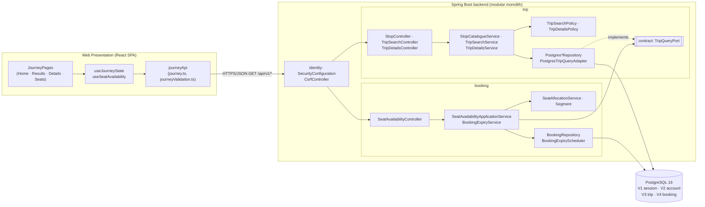
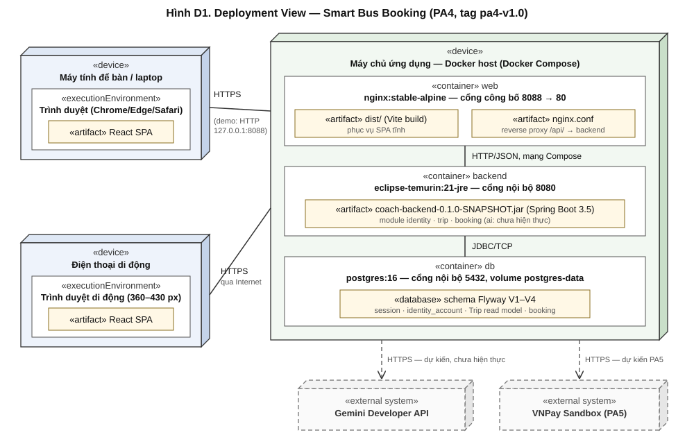

# Smart Bus Booking & Operations Management System — Software Architecture Document

Team 11 · Phiên bản **2.0 (nháp PA4)** · 19/11/2026 · Tài liệu: `PA4_Group11_SAD_v2.0`

> Bản PA4 kế thừa [PA3_Group11_SAD_v1.3_final.pdf](PA3_Group11_SAD_v1.3_final.pdf) (giữ nguyên, không ghi đè).
> Mục 1–4 được cập nhật theo phần đã hiện thực; mục 5 và 6 được điền mới. Nội dung đối chiếu
> nhánh `main` tại tag `pa4-v1.0` (commit `6e4f9aa`). Hình, sơ đồ lớp và luồng chi tiết của PA3
> vẫn có hiệu lực khi mục tương ứng dưới đây ghi "giữ nguyên PA3".

## Lịch sử phiên bản

| Ngày | Phiên bản | Mô tả | Tác giả |
|---|---|---|---|
| 09/11/2026 | 1.3 | Bản nộp PA3: mục 1–4, mục 5–6 để trống. | Đinh Đức Hiếu (tổng hợp) |
| 19/11/2026 | 2.0 nháp | Cập nhật mục 1–4 theo hiện thực PA4 (P04/P05/P07, Account V2, Trip V3, Booking V4, giao diện F1–F4); bổ sung mục 5 Deployment (UML) và mục 6 Implementation View. Chưa nhận feedback TA cho SAD PA3 nên chưa có mục sửa theo feedback. | Đinh Đức Hiếu (tổng hợp từ bàn giao của Minh Phương, Nhật Huy, Khánh Hoàng, Liên Trung Hiếu) |

**Trạng thái rà soát:** Minh Phương rà mục 4.3, Nhật Huy rà mục 4.4, Khánh Hoàng rà mục 4.1/6,
Liên Trung Hiếu duyệt cuối. Chưa có xác nhận rà soát tại thời điểm viết.

## Mục lục

1. Introduction
2. Architectural Goals and Constraints
3. Use-Case Model
4. Logical View (4.1 Web Presentation · 4.2 Identity & Access · 4.3 Trip & Operations · 4.4 Booking & Payment · 4.5 AI Assistance)
5. Deployment
6. Implementation View
- Phụ lục A. Thay đổi so với SAD PA3 · Phụ lục B. Vấn đề còn mở

---

## 1. Introduction

**Mục đích.** Tài liệu mô tả kiến trúc của Smart Bus Booking & Operations Management System: mục tiêu
và ràng buộc kiến trúc, mô hình use case, các thành phần chính và quan hệ giữa chúng, cách hệ thống được
triển khai lên các nút phần cứng/thực thi và cách tổ chức mã nguồn. Bản PA4 dùng làm căn cứ để kiểm thử
phiên bản phần mềm `pa4-v1.0` và tiếp tục hiện thực ở PA5.

**Phạm vi.** Hệ thống là ứng dụng web responsive cho một nhà xe liên tỉnh, phục vụ Passenger, Staff và
Administrator; phạm vi thiết kế gồm 20 use case (UC-P01–P12, UC-S01–S04, UC-A01–A04) và hành vi hỗ trợ
UC-C01, như PA3. Ngoài phạm vi giữ nguyên PA3: thanh toán thật, nhiều nhà xe, nhắn tin/email tự động, nhắc
giờ, bắt buộc quét QR, song ngữ, chuyển hội thoại AI sang nhân viên.

**Phạm vi đã hiện thực ở PA4.** Luồng tra cứu công khai của Passenger:
UC-P04 Search Trips → UC-P05 View Trip Details → UC-P07 View Seat Availability, chạy với backend và
PostgreSQL thật. Các UC còn lại (đăng ký/đăng nhập, tạo Booking, thanh toán, vé, Staff, Admin, AI) **chưa
hiện thực**; thiết kế của chúng giữ nguyên PA3.

**Định nghĩa và thuật ngữ.** Giữ các định nghĩa PA3 (Route/Stop, Trip, Segment, Seat Hold, phân bổ hiệu
lực, Booking, Ticket, Reconciliation, UC-C01, FAQ đã duyệt, BR, Port). Bổ sung cho PA4:

- **Served Stop:** Stop đang active và thuộc ít nhất một Route active; chỉ Stop này xuất hiện trong danh mục tìm chuyến.
- **Stop index:** thứ tự 0-based của Stop trên Route (`route_stop.stop_order`). Segment là khoảng nửa mở `[fromIndex, toIndex)`; vì vậy A→B và B→C không giao nhau.
- **Booking cutoff (`bookingClosesAt`):** giờ rời Stop đầu tuyến trừ 30 phút; đúng mốc cutoff là đã đóng bán. Không dùng giờ tại Stop lên trung gian.
- **Booking eligibility:** kết luận của server trên trang chi tiết (`allowed` + `reasons`) gồm `TRIP_NOT_SCHEDULED`, `BOOKING_CLOSED`, `ESSENTIAL_DATA_INCOMPLETE`, theo đúng thứ tự, không trùng.
- **Essential data:** cấu hình bắt buộc để bán một Trip: TripStop có giờ, đủ LegFare cho mọi cặp Stop liền kề của toàn Trip, Vehicle/SeatLayout và PhysicalSeat.
- **Trạng thái ghế hiển thị:** `FREE`, `UNAVAILABLE` (do server trả) và `UNKNOWN` (chỉ phía UI, khi dữ liệu không còn được xác minh).
- **`asOf` / `serverTime`:** một thời điểm do server lấy một lần cho mỗi request đọc; mọi phép so sánh cutoff/expiry trong request dùng cùng giá trị này và giá trị được trả cho client.
- **Snapshot đọc:** transaction read-only `REPEATABLE_READ`, mọi truy vấn Trip/Booking trong một request nhìn cùng một trạng thái dữ liệu.

**Chữ viết tắt.** Giữ PA3; bổ sung: CI (Continuous Integration), IT (Integration Test), JRE (Java Runtime
Environment), SPA (Single-Page Application), VN (giờ Việt Nam, Asia/Ho_Chi_Minh).

**Tài liệu tham khảo.**

- Team 11, SAD PA3 v1.3 (09/11/2026); Vision 1.8; Use-Case Specifications edition 1.8; Software Development Plan 1.7.
- Đề PA4 môn CSC13002 ([pa/PA4/PA4.pdf](../../pa/PA4/PA4.pdf)); mẫu `rup_sad`, test-cases/test-report v1.1 trên Moodle.
- Contract PA4: [C1_DECISIONS](../../pa/PA4/C1_DECISIONS.md), [OpenAPI 0.1](../contracts/openapi.yaml), [TripQueryPort](../contracts/trip-query-port.md), [P2/P4 design decisions](../contracts/p2-p4-design-decisions.md), [Identity Account](../contracts/identity-account.md), [kiến trúc](../contracts/architecture.md).
- Bàn giao module: [P1 manifest](../test/p1-trip-demo-manifest.md), [P2 handoff](../test/p2-b-trip-search-handoff.md), [P4 handoff](../test/p4-trip-details-handoff.md), [Booking README](../../src/backend/src/main/java/vn/edu/team11/coach/booking/README.md), [FE handoff](../test/fe-api-integration-handoff.md), [UI prototype](pa4-ui-prototype.md).

**Tổng quan tài liệu.** Mục 2 nêu mục tiêu/ràng buộc và trạng thái hiện thực. Mục 3 là mô hình use case và
phạm vi PA4. Mục 4 mô tả kiến trúc tổng thể và từng thành phần. Mục 5 là sơ đồ triển khai UML và mô tả
nút. Mục 6 là cấu trúc thư mục mã nguồn.

## 2. Architectural Goals and Constraints

### 2.1 Mục tiêu kiến trúc (Vision 1.8 mục 6)

Giữ nguyên tám mục tiêu PA3. Cột cuối nêu những gì đã có ở PA4.

| Mục tiêu | Nội dung (tóm tắt PA3) | Trạng thái PA4 |
|---|---|---|
| Toàn vẹn đặt chỗ (NFR03) | Không hai phân bổ hiệu lực trên Segment giao nhau; hold hết hạn sau 10 phút | Schema V4 ràng buộc expiry = tạo + 10 phút; logic giao Segment `[from,to)` và hết hạn tại `asOf ≥ expiresAt` có unit/IT. Chưa có thao tác tạo hold (P08). |
| Độ tin cậy (NFR06) | Báo lỗi rõ, không để phân bổ dở dang | Lỗi truy xuất trả 503, không giả FREE/giá 0. Job dọn hold rollback toàn bộ khi lỗi. |
| Đúng đắn thanh toán (NFR05) | Server xác minh kết quả thanh toán | Chưa hiện thực. |
| Bảo mật (NFR04) | Xác thực, phân quyền, quyền tối thiểu | Chỉ 4 GET công khai được mở bằng matcher chính xác; route khác yêu cầu xác thực, request ghi cần CSRF. Chưa có login. |
| Độ tin cậy AI (NFR08) | AI chỉ dùng dữ liệu thật, có fallback | Chưa hiện thực. |
| Hiệu năng (NFR02) | P04/P05 p95 ≤ 3 giây trong benchmark lớp học | Chưa đo benchmark. |
| Khả dụng (NFR01) | 360–430 px và ≥ 1280 px; Chrome/Edge/Safari | Giao diện bốn màn có ảnh desktop/mobile; kiểm thử trình duyệt ghi trong báo cáo Q3. |
| Bảo trì/kiểm thử (NFR07) | Review trước merge, test tự động, tài liệu API | CI chạy FE lint/typecheck/test/build và BE verify với PostgreSQL 16; OpenAPI 0.1 mô tả 4 GET. |

### 2.2 Ràng buộc kiến trúc và công nghệ

| Ràng buộc | PA3 (thiết kế) | Hiện thực PA4 |
|---|---|---|
| Kiểu kiến trúc | n-tier / modular monolith, một PostgreSQL | Giữ nguyên: một Spring Boot app, module `identity`, `trip`, `booking`; `ai` chưa tạo. |
| Backend | Java 21, Spring Boot, Maven, Flyway | Java 21, Spring Boot 3.5.16, Maven Wrapper 3.3.4 (Maven 3.10.0), Flyway V1–V4. |
| Truy cập dữ liệu | Spring Data JPA kết hợp SQL và khóa dòng | Starter JPA có trong build, nhưng các luồng đọc PA4 dùng SQL tường minh qua `JdbcTemplate`; job dọn hold dùng `FOR UPDATE SKIP LOCKED`. |
| Frontend | React + TypeScript + Vite + Tailwind | React 19.3, TypeScript 5.9, Vite 8.3, Tailwind CSS 4.3, Vitest 5; Node 24.19.0. |
| CSDL | PostgreSQL | PostgreSQL 16 (Compose, test và CI cùng major). |
| Xác thực | Spring Security + Spring Session JDBC, cookie HttpOnly/SameSite=Lax, CSRF, timeout 30/15 phút | Spring Security + Spring Session JDBC (V1), CSRF qua `GET /api/session/csrf`, timeout nền tảng 30 phút. Chưa có login và timeout theo role. |
| Transaction | REQUIRED, READ COMMITTED + khóa bi quan cho ghi | Đọc P04/P05/P07: read-only `REPEATABLE_READ`, một `asOf`. Ghi (job hết hạn hold): REQUIRED, khóa dòng. Thiết kế khóa của P08–P10/S03/S04 giữ nguyên PA3. |
| Dữ liệu chuẩn | UUID, UTC, VND số nguyên, ngày theo Stop lên | Giữ nguyên; thời điểm JSON là ISO-8601 UTC kết thúc bằng `Z`; tiền là số nguyên VND. |
| Môi trường | Prototype, Docker Compose, dữ liệu thử | Docker Compose ba container (web, backend, db); HTTP loopback `127.0.0.1:8088`, chưa có HTTPS/triển khai công khai. Dữ liệu demo nạp từ fixture SQL. |
| Thanh toán / AI | PA4 mock, PA5 VNPay Sandbox; Gemini qua gateway | Chưa hiện thực trong PA4. |

## 3. Use-Case Model

Mô hình use case giữ nguyên PA3 (requirements baseline 1.5, UC edition 1.8; Hình 1–6 của SAD PA3, nguồn
`PA3_Group11_UseCaseModel_v2.2.drawio`): 20 use case mục tiêu người dùng, ba actor chính Passenger, Staff,
Administrator; actor hỗ trợ Gemini (P11/P12) và VNPay Sandbox (P09, PA5); UC-S03 «include» UC-C01;
UC-P10 «extend» UC-P06.

**Use case được chọn cho PA4.** Người giao việc chốt ngày 12/11/2026 ba UC của view *Passenger Discovery*
và *Booking* làm luồng chính của phiên bản chạy được và của 30 ca kiểm thử chức năng:

| UC | Tên | Actor | Hiện thực PA4 | API |
|---|---|---|---|---|
| UC-P04 | Search Trips | Passenger (không cần đăng nhập) | Đã hiện thực, có UI | `GET /api/v1/stops`, `GET /api/v1/trips` |
| UC-P05 | View Trip Details | Passenger (không cần đăng nhập) | Đã hiện thực, có UI | `GET /api/v1/trips/{tripId}` |
| UC-P07 | View Seat Availability | Passenger (không cần đăng nhập) | Đã hiện thực, có UI; chỉ đọc | `GET /api/v1/trips/{tripId}/seat-availability` |
| UC-P01–P03, P06, P08–P12, S01–S04, A01–A04 | — | — | Chưa hiện thực | — |

Luồng sự kiện và BR (BR-P04-01…05, BR-P05-01…03, BR-P07-01…04) nằm trong đặc tả use case, không lặp lại
ở đây. UC-P07 trong PA4 dừng ở việc xem ghế: không tạo Booking, không giữ chỗ.

## 4. Logical View

### 4.0 Kiến trúc tổng thể

Giữ phân rã năm thành phần của PA3 (Hình 7–8): Web Presentation; Identity & Access; Trip & Operations;
Booking & Payment; AI Assistance. Trong backend, mỗi module chia lớp `api` (controller/DTO HTTP),
`application` (điều phối use case, transaction), `domain` (quy tắc nghiệp vụ thuần), `infrastructure`
(SQL/PostgreSQL, cấu hình bean) và `contract` (port/DTO công bố cho module khác). Module khác chỉ được
import `contract`.

Hình L1 là phần đã hiện thực ở PA4 và các phụ thuộc giữa chúng.



*Hình L1. Logical View — thành phần đã hiện thực ở PA4 (nguồn Mermaid trong tài liệu này).*

**Kết nối và giao tiếp.** Giữ nguyên PA3: trình duyệt ⇄ backend qua JSON trên HTTPS cùng origin (reverse
proxy), khóa camelCase, lỗi `{code, message, fieldErrors}`; module gọi nhau trực tiếp trong tiến trình qua
port; dịch vụ ngoài nằm sau adapter. Điểm mới ở PA4:

- Booking lấy dữ liệu Trip duy nhất qua `TripQueryPort.getSeatAvailabilityFacts(tripId, fromStopId, toStopId, asOf)`; adapter Trip tham gia transaction của caller (`MANDATORY`) nên Trip và Booking được đọc trong cùng snapshot.
- Trang chi tiết (P05) không dùng `TripQueryPort` (port strict chỉ trả facts khi Trip bán được); P05 có repository riêng để dựng thông tin một phần đã xác minh.
- Mọi response nghiệp vụ có `Cache-Control: no-store` và `serverTime`.

**Bảng ánh xạ HTTP → thành phần → mã lỗi (OpenAPI 0.1).**

| Endpoint | Thành phần | Thành công | Lỗi |
|---|---|---|---|
| `GET /api/v1/stops` | Trip | 200 `{items, serverTime}` (có thể rỗng) | 503 `TRIP_DATA_UNAVAILABLE`, 500 |
| `GET /api/v1/trips?fromStopId&toStopId&boardingDate&page&size` | Trip | 200 trang kết quả (rỗng vẫn 200) | 400 `INVALID_REQUEST`; 422 `INVALID_SEGMENT`/`STOP_NOT_SERVED`/`PAST_BOARDING_DATE`; 503; 500 |
| `GET /api/v1/trips/{tripId}[?fromStopId&toStopId]` | Trip | 200 chi tiết + `bookingEligibility` (kể cả khi không bán được) | 400; 404 `TRIP_NOT_FOUND`; 422; 503; 500 |
| `GET /api/v1/trips/{tripId}/seat-availability?fromStopId&toStopId` | Booking (qua TripQueryPort) | 200 layout + trạng thái từng ghế (hết ghế vẫn 200) | 400; 404; 422; 409 `TRIP_NOT_BOOKABLE`/`ESSENTIAL_DATA_INCOMPLETE`; 503 `AVAILABILITY_UNAVAILABLE`; 500 |

### 4.1 Component: Web Presentation

**Trách nhiệm.** Giữ nguyên PA3: chỉ hiển thị và gọi API của module sở hữu nghiệp vụ; không tự quyết định
cutoff, giá, availability hay quyền. Danh sách lớp thiết kế (WebAppShell, TripSearchPage, TripDetailsPage,
ApiClient, TripApi, BookingApi, …) và Hình 9 vẫn là thiết kế đích.

**Hiện thực PA4.** Bốn màn Home/tìm chuyến, Kết quả, Chi tiết, Tình trạng ghế (mô tả và ảnh trong
[pa4-ui-prototype.md](pa4-ui-prototype.md)). Ánh xạ lớp thiết kế PA3 → mã nguồn:

| Lớp PA3 | Hiện thực (`src/frontend/src/`) | Ghi chú |
|---|---|---|
| WebAppShell | `App.tsx` | Header, điều hướng bốn màn; trang Lịch trình ẩn trong bản demo. |
| TripSearchPage / TripDetailsPage / (Seat map) | `features/journey/JourneyPages.tsx` | Render dữ liệu và các trạng thái loading/rỗng/lỗi/retry. |
| SearchCriteriaViewModel / TripDetailsViewModel | `features/journey/useJourneyState.ts` | Giữ tiêu chí nháp và đã gửi, Trip/Segment đã chọn; bỏ qua response cũ khi đổi tiêu chí/màn. |
| (ViewModel ghế) | `features/journey/useSeatAvailability.ts` | Refresh 15 giây khi tab hiển thị, khi quay lại foreground, tại expiry/cutoff; lỗi refresh → hiển thị UNKNOWN, không giữ FREE cũ. |
| ApiClient + TripApi/BookingApi | `shared/api/journey.ts`, `journeyValidation.ts`, `journeyTypes.ts` | Bốn hàm GET, `cache: 'no-store'`, `AbortSignal`, kiểm tra cấu trúc response, ánh xạ lỗi vào `JourneyApiError`. |

Quyết định: nút sang màn ghế chỉ bật khi `bookingEligibility.allowed = true` và Segment đã chọn; giá/giờ
null hiển thị "chưa có", không thay bằng 0. Giao diện không có nút đặt chỗ/thanh toán.

### 4.2 Component: Identity & Access

**Trách nhiệm và thiết kế lớp.** Giữ nguyên PA3 (Account, Role, AuthenticationService, LoginAttemptTracker,
Session, SessionService, AuthorizationService, RequesterContext; Hình 10).

**Hiện thực PA4 (một phần).**

- Flyway V1: bảng Spring Session JDBC. Flyway V2: `identity_account(account_id UUID PK, email unique, password_hash, full_name, phone, status, role)` với ràng buộc role ∈ {PASSENGER, STAFF, ADMINISTRATOR} theo [contract I1](../contracts/identity-account.md). Bảng này là prerequisite cho FK `booking.passenger_account_id`.
- `SecurityConfiguration`: mặc định mọi route cần xác thực; chỉ mở `GET /api/health`, `GET /api/session/csrf` và đúng bốn GET công khai ở mục 4.0 bằng matcher chính xác. Phương thức ghi, endpoint lồng khác và route riêng tư vẫn bị chặn; request ghi cần CSRF token qua header `X-CSRF-TOKEN`.
- `CsrfController`: cấp CSRF token cho SPA.
- **Chưa hiện thực:** đăng ký/đăng nhập/đăng xuất (P01–P03), LoginAttemptTracker, timeout 15 phút cho Staff/Admin, ownership P06. Fixture hai Passenger trạng thái DISABLED chỉ để thỏa FK dữ liệu demo, không đăng nhập được.

### 4.3 Component: Trip & Operations

**Trách nhiệm.** Giữ nguyên PA3: sở hữu Vehicle, PhysicalSeat, Stop, Route, RouteStop, Schedule, Trip,
TripStop, LegFare; phục vụ truy vấn công khai P04/P05 và cung cấp `TripQueryPort` chỉ đọc cho Booking/AI.
Thiết kế Admin/Staff (A01–A03, S01–S04), chính sách Schedule–Trip, snapshot dữ liệu vé và các kịch bản
tranh chấp (mục 4.3 PA3, Hình 11) giữ nguyên, chưa hiện thực.

**Mô hình dữ liệu V3 (`V3__trip_read_model.sql`).** Chín bảng `route`, `stop`, `route_stop`, `vehicle`,
`physical_seat`, `schedule`, `trip`, `trip_stop`, `leg_fare`. So với lớp PA3:

- `route_stop.stop_order` bắt đầu từ 0; UK(route_id, stop_order).
- `trip.status` ∈ {Scheduled, Departed, Completed, Cancelled}; `trip_stop` lưu `planned_arrival_time`/`planned_departure_time` dạng `TIMESTAMPTZ`, có ràng buộc ít nhất một giờ và arrival ≤ departure.
- `vehicle.seat_layout_id` (UUID, NOT NULL, unique) và `layout_template` là định danh layout; không có bảng layout riêng. `physical_seat` có toạ độ (deck, seat_row, seat_column) và nhãn duy nhất trong xe.
- `leg_fare` PK(trip_id, from_stop_id, to_stop_id), hai FK ghép về `trip_stop`, giá ≥ 0. Giá Segment = tổng LegFare liền kề; giá 0 hợp lệ, thiếu dòng là thiếu dữ liệu.
- V3 chưa có nguồn mô tả chuyến nên `description` luôn trả `null`.

**Lớp chính đã hiện thực (`vn.edu.team11.coach.trip`).**

| Lớp | Tầng | Trách nhiệm |
|---|---|---|
| `StopController`, `TripSearchController`, `TripDetailsController` | api | Nhận GET, gọi parser, map exception → HTTP. |
| `TripSearchRequestParser`, `TripDetailsRequestParser` | api | Kiểm tra UUID, ngày `YYYY-MM-DD`, tham số trùng, cặp Stop cùng có/cùng vắng, paging (`size` ≤ 100). |
| `StopCatalogueService` | application | Đọc danh mục Served Stop trong transaction read-only, sắp theo tên rồi ID. |
| `TripSearchService`, `TripDetailsService` | application | Lấy một `asOf` từ `Clock`, mở transaction read-only `REPEATABLE_READ`, gọi repository và policy. |
| `TripSearchPolicy` | domain | Lọc Trip Scheduled, đúng ngày lên tại Stop lên (giờ VN), trước cutoff; cộng giá leg; candidate thiếu essential → lỗi 503 thay vì bỏ qua; sắp xếp theo giờ lên rồi tripId. |
| `TripDetailsPolicy` | domain | Dựng chi tiết đã xác minh, `selectedSegment`, `bookingEligibility` với reasons theo thứ tự. |
| `Postgres*Repository` | infrastructure | SQL đọc dữ liệu V3, tham gia transaction của service (`MANDATORY`). |
| `TripQueryPort`, `TripSeatFacts`, `SeatLayout`, `LayoutSeat`, `TripQueryException`/`TripQueryErrorCode` | contract | Port strict cho Booking: chỉ thành công khi Trip Scheduled, trước cutoff, Segment hợp lệ, essential đầy đủ; lỗi typed `TRIP_NOT_FOUND`, `STOP_NOT_SERVED`, `INVALID_SEGMENT`, `TRIP_NOT_BOOKABLE`, `ESSENTIAL_DATA_INCOMPLETE`, `TRIP_DATA_UNAVAILABLE`. |
| `PostgresTripQueryAdapter` | infrastructure | Hiện thực `TripQueryPort` bằng PostgreSQL trong snapshot của caller; không đọc/ghi allocation. |

**Quyết định PA4 cần lưu ý.** Trip tồn tại nhưng không bán được (đã huỷ, quá cutoff, thiếu dữ liệu, Route/Stop
inactive) vẫn trả 200 chi tiết một phần với `allowed=false`; chỉ lỗi truy xuất thật trả 503. Trường hợp
Route/Stop inactive đang chờ leader xác nhận (Phụ lục B).

### 4.4 Component: Booking & Payment

**Trách nhiệm.** Giữ nguyên PA3: sở hữu Booking, BookingSeat, SeatAllocation, PaymentAttempt,
PaymentTransaction, Ticket, RefundRequest, ReconciliationCase; port `BookingQueryPort`,
`BookingOperationsPort`, `PaymentGatewayPort`; bất biến và transaction liên module (Hình 12).
PA4 hiện thực phần dữ liệu ghế, xem availability (P07) và dọn hold hết hạn; P08–P10, thanh toán, vé chưa
hiện thực.

**Mô hình dữ liệu V4 (`V4__booking_availability.sql`).**

- `booking`: Trip, Segment (Stop và index), `status` ∈ {Pending, Confirmed, Expired, Cancelled}, `total_amount_vnd`, `hold_created_at`, `expires_at` với ràng buộc `expires_at = hold_created_at + 10 phút`; FK tới `identity_account`, `trip`, `trip_stop`.
- `booking_seat`: một ghế vật lý của Booking, tên hành khách, giá ghế; UK(booking_id, physical_seat_id).
- `seat_allocation`: phân bổ (Hold/Confirmed) của một BookingSeat trên Trip/Segment, `released_at`; FK ghép giữ allocation cùng Trip, Segment, ghế và expiry với Booking cha.
- Migration không seed dữ liệu; dữ liệu demo nằm trong fixture test.

**Lớp chính đã hiện thực (`vn.edu.team11.coach.booking`).**

| Lớp | Tầng | Trách nhiệm |
|---|---|---|
| `SeatAvailabilityController`, `SeatAvailabilityExceptionHandler`, `SeatAvailabilityResponse` | api | GET công khai, map lỗi port/repository → HTTP, header `no-store`, không lộ Booking/hành khách. |
| `SeatAvailabilityApplicationService` | application | Một `asOf`; transaction read-only REQUIRED/`REPEATABLE_READ`; gọi `TripQueryPort` rồi `BookingRepository` trong cùng snapshot; trả đủ ghế theo layout. |
| `SeatAllocationService`, `Segment`, `SeatAllocation`, `BookingStatus` | domain | Giao Segment nửa mở; Confirmed chưa release luôn chặn; Hold chỉ chặn khi `asOf < expiresAt`; ghế bị Hold chặn trả expiry sớm nhất. |
| `BookingRepository` | infrastructure | SQL đọc allocation hiệu lực; ghi chuyển Pending→Expired và release Hold. |
| `BookingExpiryService`, `BookingExpiryScheduler`, `BookingConfiguration` | application/infrastructure | Job H3: khóa Pending đến hạn bằng `FOR UPDATE SKIP LOCKED`, chuyển Expired và release Hold trong một transaction; idempotent; cấu hình `BOOKING_EXPIRY_CLEANUP_ENABLED` (mặc định true) và `BOOKING_EXPIRY_CLEANUP_INTERVAL` (mặc định PT5S). |

**Quyết định PA4.** GET không giữ chỗ, không ghi DB và không kích hoạt job; ghế hết hạn hiển thị FREE ngay
tại expiry dù job chưa chạy. Hết ghế là 200 với mọi ghế UNAVAILABLE; không xác minh được dữ liệu là 503,
không đoán FREE. Response availability chỉ là ảnh chụp, không bảo đảm giữ được ghế ở thao tác sau.

### 4.5 Component: AI Assistance

Giữ nguyên PA3 (mục 4.5, Hình 13): AI chỉ đọc qua `TripQueryPort` và
`BookingQueryPort.getOwnedBookingFacts`, gọi Gemini Developer API từ backend qua `LlmGateway/GeminiGateway`,
có fallback. PA4 chưa tạo module `ai`, chưa gọi Gemini. Lưu ý cho PA5: `TripQueryPort` hiện mới có
`getSeatAvailabilityFacts`; thao tác tìm chuyến cho AI cần bổ sung vào contract khi hiện thực.

## 5. Deployment



*Hình D1. Sơ đồ triển khai UML của phiên bản `pa4-v1.0` (nguồn chỉnh sửa: [diagrams/pa4-deployment.puml](diagrams/pa4-deployment.puml)). Nét đứt là hệ thống ngoài dự kiến, chưa kết nối ở PA4.*

### 5.1 Mô tả các nút

| Nút | Loại | Thành phần chạy trên nút | Ghi chú |
|---|---|---|---|
| Máy tính để bàn / laptop | «device» | Trình duyệt Chrome/Edge/Safari chạy React SPA | Passenger tra cứu; Staff/Admin dùng trong các PA sau. Màn hình ≥ 1280 px. |
| Điện thoại di động | «device» | Trình duyệt di động chạy cùng React SPA | Passenger chủ yếu dùng điện thoại; viewport 360–430 px. Không có ứng dụng native. |
| Máy chủ ứng dụng (Docker host) | «device» | Docker Engine + Docker Compose, ba container dưới đây | Môi trường demo lớp học; một máy. |
| ↳ `web` | «container» `nginx:stable-alpine` | `dist/` do Vite build; `nginx.conf` phục vụ SPA và proxy `/api/` sang `backend:8080` | Container duy nhất công bố cổng ra ngoài: `127.0.0.1:8088` → 80. Image build chạy lint/typecheck/test/build trước khi đóng gói. |
| ↳ `backend` | «container» `eclipse-temurin:21-jre` | `coach-backend-0.1.0-SNAPSHOT.jar` (Spring Boot 3.5, module identity/trip/booking, job dọn hold) | Chỉ nghe 8080 trong mạng Compose, chạy user không phải root (10001); healthcheck `GET /api/health`; Flyway migrate V1–V4 khi khởi động. TZ=UTC. |
| ↳ `db` | «container» `postgres:16` | CSDL `team11_coach`, volume `postgres-data` | Chỉ nghe 5432 trong mạng Compose; healthcheck `pg_isready`. |
| Gemini Developer API | «external system» | Dịch vụ LLM của Google | Dự kiến cho P11/P12; chưa kết nối. Gọi từ backend, không từ trình duyệt. |
| VNPay Sandbox | «external system» | Cổng thanh toán thử | Dự kiến PA5 cho P09; chưa kết nối. |

### 5.2 Liên kết

| Liên kết | Giao thức | Ghi chú |
|---|---|---|
| Trình duyệt ⇄ `web` | HTTPS khi triển khai qua Internet; demo PA4 dùng HTTP trên loopback | Cùng origin cho SPA và `/api`; cookie phiên HttpOnly, SameSite=Lax; `Secure` bật khi có HTTPS. |
| `web` → `backend` | HTTP/JSON trong mạng Compose | Nginx thêm `X-Forwarded-*`. |
| `backend` → `db` | JDBC/TCP 5432 trong mạng Compose | Một DataSource; transaction Spring. |
| `backend` → Gemini / VNPay | HTTPS (dự kiến) | Qua adapter `GeminiGateway`/`PaymentGatewayPort`; không gọi khi đang giữ khóa DB. |

### 5.3 Các cấu hình triển khai khác

- **Phát triển:** `compose.dev.yaml` mở thêm DB 5432 và backend 8080 trên loopback; Vite dev server proxy `/api` tới 8080.
- **Kiểm thử backend:** `compose.test.yaml` (project riêng) chạy Maven `verify` trên `maven:3.9-eclipse-temurin-21` với PostgreSQL 16 trên tmpfs; không dùng volume phát triển.
- **CI:** GitHub Actions (`.github/workflows/ci.yml`) chạy FE lint/typecheck/Vitest/build và BE verify với PostgreSQL 16.
- Cấu hình ở Hình D1 đã được dựng từ tag `pa4-v1.0` (DB tách riêng trên tmpfs) và chạy 30 ca kiểm thử chức năng ngày 20/11/2026; xem [báo cáo kiểm thử](../test/pa4-test-report.md).
- Chưa có môi trường triển khai công khai, HTTPS/TLS hay production.

## 6. Implementation View

Cấu trúc thư mục chính của repository `coach-transportation-management-system` tại `pa4-v1.0`:

```text
coach-transportation-management-system\
├── compose.yaml                 Ứng dụng demo: web + backend + db
├── compose.dev.yaml             Override phát triển (mở port loopback)
├── compose.test.yaml            Backend verify với PostgreSQL tmpfs
├── .github\workflows\ci.yml     CI frontend + backend
├── AGENTS.md, CONTRIBUTING.md, README.md, SETUP_CI.md
├── docs\
│   ├── analysis and design\     SAD PA3 (PDF + bản trích), SAD PA4, UI prototype, images\, diagrams\
│   ├── contracts\               architecture, data-and-api, openapi.yaml, trip-query-port, examples\*.json
│   ├── requirements\            Use-Case Specifications (PDF + bản trích)
│   ├── management\              Weekly report, bàn giao leader
│   └── test\                    Test plan, test cases (.md, .xlsx), báo cáo kiểm thử, handoff, sql\ kịch bản QA
├── pa\PA0 … PA5\                Đề bài và tài liệu điều phối từng PA (PA4: SCOPE, TASKS, C1_DECISIONS)
└── src\
    ├── frontend\                React + TypeScript + Vite
    │   ├── Dockerfile, nginx.conf   Build bundle, phục vụ bằng Nginx, proxy /api/
    │   ├── package.json, package-lock.json, vite.config.ts, tsconfig*.json, eslint.config.js
    │   ├── public\
    │   └── src\
    │       ├── App.tsx, main.tsx, index.css
    │       ├── features\journey\    JourneyPages.tsx, useJourneyState.ts, useSeatAvailability.ts, journey.css
    │       ├── shared\api\          journey.ts, journeyTypes.ts, journeyValidation.ts, health.ts
    │       └── test\                Vitest + Testing Library
    └── backend\                 Java 21 + Spring Boot (Maven Wrapper)
        ├── Dockerfile, pom.xml, mvnw, mvnw.cmd, .mvn\wrapper\
        └── src\
            ├── main\
            │   ├── java\vn\edu\team11\coach\
            │   │   ├── CoachBackendApplication.java
            │   │   ├── identity\    api\ (CsrfController), infrastructure\ (SecurityConfiguration)
            │   │   ├── trip\        api\, application\, domain\, infrastructure\, contract\ (TripQueryPort)
            │   │   └── booking\     api\, application\, domain\, infrastructure\, README.md
            │   └── resources\
            │       ├── application.yaml
            │       └── db\migration\  V1__spring_session.sql, V2__identity_account.sql,
            │                          V3__trip_read_model.sql, V4__booking_availability.sql
            └── test\
                ├── java\vn\edu\team11\coach\   unit tests (*Test) và PostgreSQL integration tests (*IT)
                └── resources\fixtures\         identity_accounts.sql, trip_demo*.sql, booking_*.sql
```

**Quy ước.** Mỗi module backend dùng cùng năm gói `api/application/domain/infrastructure/contract` (module
chỉ tạo gói cần dùng). Module `ai` và gói `shared` chưa tồn tại vì chưa có mã thật; không tạo gói rỗng.
Migration đã chia sẻ không sửa, thay đổi schema thêm `V5+`. Unit test do Surefire chạy, `*IT` do Failsafe
chạy với PostgreSQL thật. Fixture SQL chỉ nạp vào DB demo/test riêng, không vào DB dùng chung.

---

## Phụ lục A. Thay đổi so với SAD PA3

| Mục | Thay đổi | Lý do / nguồn |
|---|---|---|
| 1 | Thêm phạm vi đã hiện thực PA4, thuật ngữ Served Stop, Stop index 0-based, cutoff, eligibility, essential data, UNKNOWN, `asOf`, snapshot đọc; tài liệu tham khảo contract PA4 | C1, OpenAPI 0.1, bàn giao module |
| 2 | Ghi phiên bản công nghệ thực tế; đọc PA4 dùng `JdbcTemplate`/SQL thay vì JPA entity; transaction đọc `REPEATABLE_READ`; bảng trạng thái theo mục tiêu | Mã nguồn `pa4-v1.0`, handoff P2/P4/H2 |
| 3 | Đánh dấu P04/P05/P07 là UC hiện thực ở PA4 | Quyết định 12/11/2026 |
| 4.0 | Thêm Hình L1, bảng HTTP→thành phần→lỗi; P05 không dùng port strict | OpenAPI 0.1, P2/P4 design decisions |
| 4.1–4.4 | Ánh xạ lớp thiết kế → lớp hiện thực; schema V2/V3/V4; quyết định 200 + eligibility false; job dọn hold | Bàn giao Phương, Huy, Hoàng/Trung Hiếu |
| 5 | Mới: sơ đồ triển khai UML và mô tả nút/liên kết | Đề PA4 mục a |
| 6 | Mới: cấu trúc thư mục mã nguồn | Đề PA4 mục a |

## Phụ lục B. Vấn đề còn mở

1. **Feedback TA cho SAD PA3** chưa nhận; khi có sẽ cập nhật lại mục 1–4 và ghi vào lịch sử phiên bản.
2. **P05 với Route/Stop inactive:** hiện trả 200 + `ESSENTIAL_DATA_INCOMPLETE`; Liên Trung Hiếu chưa xác nhận chính thức.
3. **Rà soát nội dung module:** Phương (4.3), Huy (4.4), Hoàng (4.1) chưa xác nhận bản nháp này; Hoàng chưa xác nhận đã xem lại phần tích hợp F2–F4.
4. **Chưa hiện thực:** login/role timeout, P08–P12, Staff/Admin, thanh toán, AI; benchmark NFR02; HTTPS.
5. Kết quả kiểm thử chức năng theo mã ca nằm trong báo cáo Q3 ([pa4-test-report.md](../test/pa4-test-report.md)), không suy từ kết quả CI.
